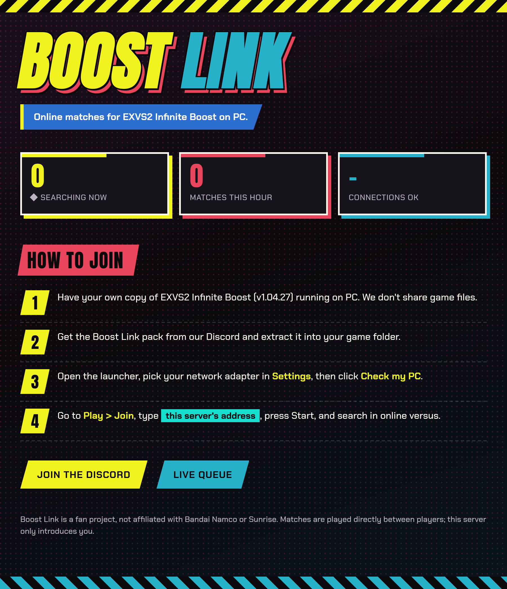

# Boost Link

Online matchmaking for EXVS2 Infinite Boost on PC. A fan project, not affiliated with
Bandai Namco or Sunrise. **This repository contains no game files**; every player brings
their own copy of the game (v1.04.27).



## What's here

| Folder | What it is |
|---|---|
| `exvs-online/` | The proxy + matchmaking server (Go). Sits between the game and the card server, runs matchmaking, STUN/TURN relay, status page, home page, pre-match check (`-check`). |
| `launcher/` | The Boost Link launcher (Go, Windows): one click to start the card server, matchmaking proxy, Live Monitor and game. Host / Join / offline, Check my PC. |
| `english/` | English patch tools: `exvs-english` (exe strings) and `exvs-ui` (installs translated screen files), plus the `repaint/` toolkit used to build them. |
| `server/` | Linux server kit: `install.sh` sets up matchmaking + relay as a service on a $5 VPS. |
| `docs/` | Reverse-engineering notes and the friend test plan. |

## Getting it (players)

Download `friend-pack.zip` from the latest [Release](../../releases), extract it into your
game folder, and follow `START-HERE.txt`.

## Building

Each folder is its own Go module (Go 1.22+):

```
cd exvs-online && GOOS=windows GOARCH=amd64 go build -trimpath -ldflags "-s -w" -o exvs-online.exe .
cd launcher    && GOOS=windows GOARCH=amd64 go build -trimpath -ldflags "-s -w -H windowsgui" -o exvs-launcher.exe .
cd english     && GOOS=windows GOARCH=amd64 go build -o exvs-english.exe .
cd english/exvs-ui && GOOS=windows GOARCH=amd64 go build -o exvs-ui.exe .
```

Server (Linux): `cd exvs-online && CGO_ENABLED=0 GOOS=linux GOARCH=amd64 go build -o ../server/exvs-online-linux-amd64 .`

## Releases

Binaries and the friend pack are attached to GitHub Releases, never committed. The friend
pack includes translated screen files built from the game, so keep this repository private.
